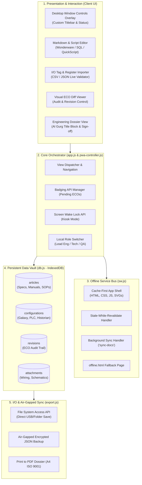

<div align="center">

# ⚡ DocuGenius Wiki (AGAC PWA)
### Automated SCADA Documentation, Configuration & Spec Vault

[](https://web.dev/progressive-web-apps/)
[](https://developer.mozilla.org/en-US/docs/Web/API/IndexedDB_API)
[](./css/print-dossier.css)
[](https://www.aveva.com/)

<p align="center">
  <b>Purpose-built for Senior SCADA & Automation Engineers at Dubai, U.A.E.)</b><br>
  Delivering 100% offline, air-gapped lifecycle management for SCADA configurations, specifications, and operator manuals.
</p>

[Key Features](#-core-capabilities-task-24) •
[Visual Assets & Logos](#-visual-identity--asset-manifest) •
[System Architecture](#-system-architecture) •
[Data Models](#-data-models--indexeddb-schema) •
[Quick Start](#-quick-start)

---

</div>

## 📌 Executive Overview: Task 24 Implementation

DocuGenius Wiki directly solves **Job Responsibility #24**:
> *"Create and maintain documentation for SCADA system configurations, design specifications, and user manuals."*

Designed to operate inside high-security, air-gapped industrial control center networks (OT environments) without external cloud dependencies. All databases, templates, diff viewers, and export compilers run entirely client-side with guaranteed persistent local storage.

---

## 🎨 Visual Identity & Asset Manifest

### 1. Embedded Telemetry Badges & Logos

| Component | Asset File | Direct Preview |
| :--- | :--- | :--- |
| **Master Telemetry Emblem** | `favicon.svg` |  |
| **App Launcher Icon** | `icons/icon-192.png` |  |
| **Maskable Adaptive Icon** | `icons/icon-maskable-192.png` |  |
| **Apple Touch Icon** | `apple-touch-icon.png` |  |
| **New Spec Shortcut** | `icons/shortcut-new.png` |  |
| **IO Import Shortcut** | `icons/shortcut-import.png` |  |
| **Audit Log Shortcut** | `icons/shortcut-audit.png` |  |

### 2. Full PWA Icon & Graphic Tree

```text
docugenius-agac-pwa/
├── favicon.svg                           # Master vector logo (Cyan #00D2FF & Emerald #10B981)
├── favicon.ico                           # Multi-size legacy browser icon
├── apple-touch-icon.png                  # iOS Springboard Icon (180x180)
├── icons/
│   ├── icon-72.png / icon-96.png         # Legacy Android launcher formats
│   ├── icon-128.png / icon-144.png       # Chrome Web Store & Windows tile manifests
│   ├── icon-152.png                      # iPad touch icon
│   ├── icon-192.png                      # Standard Android home screen icon
│   ├── icon-384.png                      # High-density splash icon
│   ├── icon-512.png                      # PWA master splash icon
│   ├── icon-maskable-192.png             # Android adaptive maskable icon (192px)
│   ├── icon-maskable-512.png             # Android adaptive maskable icon (512px)
│   ├── shortcut-new.png                  # Desktop/Mobile quick-action: New Document
│   ├── shortcut-import.png               # Desktop/Mobile quick-action: Import Tags
│   └── shortcut-audit.png                # Desktop/Mobile quick-action: ECO Log
└── screenshots/
    ├── screenshot-desktop.png            # 1280x720 Desktop landscape preview
    └── screenshot-mobile.png             # 750x1334 Mobile narrow portrait preview
```

---

## 🏛 System Architecture

The following diagram illustrates the complete runtime architecture, detailing data flow between the presentation layer, browser APIs, workers, and physical storage.



---

## ⚙️ Core Capabilities (Task 24)

### 1. Configuration Vault
* **Wonderware System Platform (ArchestrA)**: Full structural capture of Galaxy repositories, Redundant Application Engines (AppEngines), InTouch HMI View engines, scan group intervals, and object templates.
* **Network & Driver Profiles**: Document Modbus TCP/RTU station mappings (Unit ID, Port 502, Baud, Parity) and OPC DA/UA Server Endpoint URIs.
* **SQL Industrial Historian Profiles**: Retention periods (2 to 3+ years), tag deadbands, cyclic/delta storage rules, and real-time database connection strings.

### 2. Specification Vault
* **Automated I/O & Modbus Mapping Engine**:
  * Drop raw CSV/JSON PLC tag export files into `parsers.js`.
  * Automatic register categorization:
    * `0x` Coils (Discrete Read/Write)
    * `1x` Discrete Inputs (Read-Only)
    * `3x` Input Registers (Analog Read-Only)
    * `4x` Holding Registers (Analog Read/Write)
  * Auto-detects data types: `BOOLEAN`, `INT16`, `UINT16`, `FLOAT32`, `STRING`.
* **Design Specifications**: Standardized Functional Design Specs (FDS) and Software Design Specs (SDS).

### 3. User Manuals & Operator SOPs
* **Standard Operating Procedures (SOPs)**: Step-by-step procedural guides for control room plant operators.
* **Industrial Callout Blocks**:
  * `[!] DANGER`: High-voltage, arc flash, toxic gas, or critical process hazard.
  * `[i] INTERLOCK`: Automated hardware/software interlock condition rules.
  * `[*] OPERATOR NOTE`: Normal setpoint envelopes and runtime instructions.
* **FAT / SAT Acceptance Checklists**: Structured Factory and Site Acceptance Testing tables featuring pass/fail flags, punch-list trackers, and inspector sign-off tables.

---

## 🗄 Data Models & IndexedDB Schema

The IndexedDB database (`DocuGeniusDB`, Version `1`) enforces strict data integrity via four key stores:

```javascript
// Database Schema Initialization (js/db.js)
const STORES = {
  articles: { keyPath: "id", indexes: ["category", "updatedAt", "status"] },
  configurations: { keyPath: "id", indexes: ["nodeType", "galaxyName", "ipAddress"] },
  revisions: { keyPath: "revId", indexes: ["docId", "timestamp", "authorRole"] },
  attachments: { keyPath: "id", indexes: ["docId", "mimeType"] }
};
```

### Storage Persistence Guarantee
To maintain compliance over multi-year operational cycles without data eviction by mobile browsers (specifically iOS WebKit 7-day storage caps), `js/db.js` initializes storage locks:

```javascript
if (navigator.storage && navigator.storage.persist) {
  const isPersisted = await navigator.storage.persist();
  console.log(`Persistent storage lock acquired: ${isPersisted}`);
}
```

---

## 📋 Comprehensive File Inventory

| File Path | Description |
| :--- | :--- |
| `index.html` | Application shell with Window Controls Overlay title bar, responsive sidebars, editor, and dossier layout. |
| `manifest.webmanifest` | Web App Manifest with shortcuts, maskable icons, WCO settings, and industrial dark theme (`#090D16`). |
| `sw.js` | Service worker managing offline caching, stale-while-revalidate routes, and background sync. |
| `offline.html` | Fallback view rendered if a non-cached asset is requested while offline. |
| `favicon.svg` | Vector industrial telemetry badge. |
| `favicon.ico` | Fallback browser tab icon. |
| `robots.txt` | Standard search engine directives. |
| `.well-known/assetlinks.json` | Android TWA package validation config. |
| `.nojekyll` | Direct static asset serving flag for GitHub Pages. |
| `css/styles.css` | Industrial control room aesthetic (Deep Slate, Cyan `#00D2FF`, Emerald `#10B981`, Amber `#F59E0B`). |
| `css/print-dossier.css` | Print formatting with formal Al Gurg engineering title blocks, revision logs, and sign-off grids. |
| `js/db.js` | IndexedDB persistent storage engine with auto-persistence requests and quota metrics. |
| `js/templates.js` | Built-in SCADA document templates (Wonderware SDS, Modbus Map, FAT/SAT, SOP). |
| `js/parsers.js` | CSV/JSON tag parser with Modbus address space calculators. |
| `js/export.js` | File System Access API integration, JSON vault air-gap exporter, and text diff utility. |
| `js/pwa-controller.js` | Service Worker registration, OS App Badging, Screen Wake Lock, and WCO listeners. |
| `js/app.js` | Main application lifecycle, keyboard shortcuts (`Ctrl+K`), role switcher, and event bus. |
| `js/seed.js` | Realistic initial dataset featuring Dubai Municipality pumping stations and Wonderware Galaxy topologies. |

---

## 🚀 Quick Start

### 1. Prerequisites
Any modern desktop or mobile browser supporting PWA standards (Chrome, Edge, Safari, Firefox).

### 2. Local Execution

Serve the repository directory locally (Service Workers require `localhost` or an active `HTTPS` connection):

```bash
# Option A: Using Node.js
npx serve docugenius-agac-pwa

# Option B: Using Python 3
cd docugenius-agac-pwa
python3 -m http.server 8080
```

Access the app at: **`http://localhost:8080`**

### 3. Desktop Installation
1. Open the URL in **Google Chrome** or **Microsoft Edge**.
2. Click the **Install** button in the top navigation bar or the browser URL bar.
3. The app opens in an integrated desktop window with full title bar support (Window Controls Overlay).

---

## 🛡 Security & Compliance Standards

- **Air-Gapped Operation**: Zero analytics, zero external CDNs, and zero third-party font calls. All CSS, JavaScript, and fonts are stored locally.
- **Role-Based Audit Stamp**: Engineering changes (ECOs) are stamped locally using the active operator role (*Lead SCADA Engineer*, *Shift Operator*, *QA/FAT Inspector*) without requiring insecure cloud logins.
- **Quality Assurance Standards**: All printed dossiers adhere to **ISO 9001** document control standards and **Al Gurg QHSE Annexure-SCT-HR-001**.
